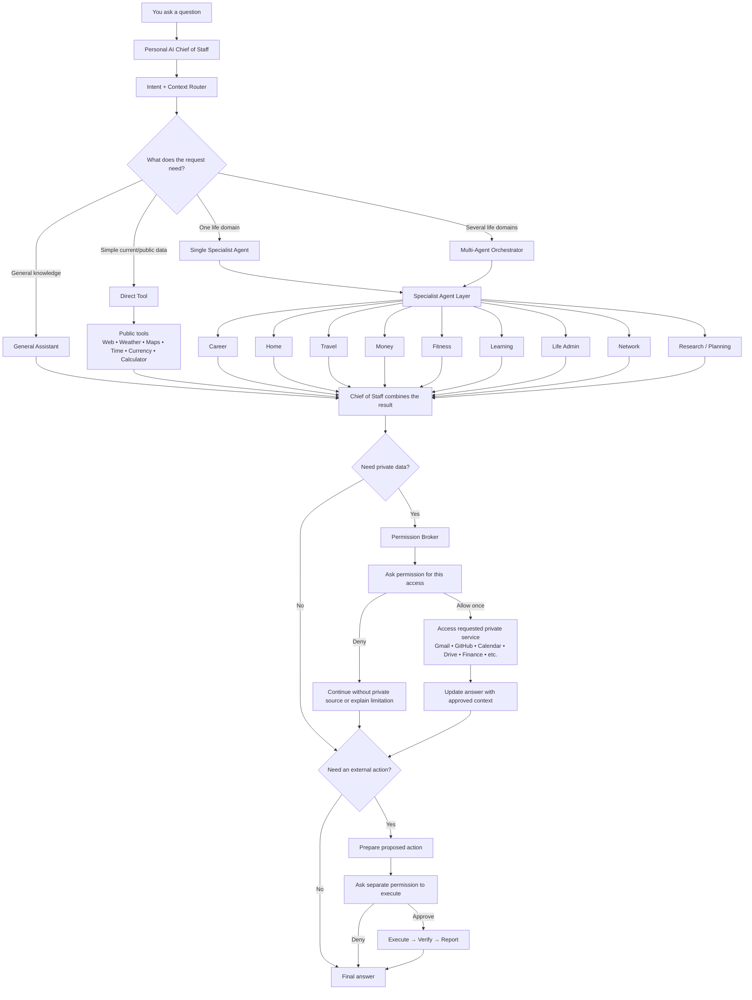

# Personal LifeOS

This repository is my personal fork of **LifeOS**. I am experimenting with it for my own use cases and, more importantly, using it as a hands-on project to learn how a practical personal AI assistant can be designed and built.

The original LifeOS project already provides a strong foundation for personal data retrieval, tools, memory, scheduling, integrations, and agent workflows. Rather than rebuilding all of that infrastructure from scratch, I am adapting the existing system into a personal assistant that better matches how I want to use AI in day-to-day life.

> The original LifeOS README has been preserved as [`LifeOS_original_ReadME.md`](LifeOS_original_ReadME.md).

## Why this fork?

A lot has changed in the AI assistant and agent ecosystem. General-purpose assistants, agent platforms, and tools such as **Grokbot** can now handle many scenarios that previously required building a complete system from scratch.

Because of that, the goal of this fork is **not** to recreate every possible AI capability. Instead, I want to explore what is worth owning and customizing myself, especially the parts that matter for a personal assistant:

- personal context and long-term memory
- routing between normal questions, tools, and specialist agents
- personal planning and decision support
- permission-aware access to private services
- safe execution of actions
- proactive workflows and reminders
- multi-agent coordination when a decision spans several parts of life

This is also a learning project for experimenting with agentic AI, RAG, tool use, orchestration, permissions, memory, and production-style AI system design.

## What I am building

The long-term goal is a **Personal AI Chief of Staff** that acts as one conversational entry point for everyday questions and tasks.

Examples include:

- answering general questions
- checking current weather or other public information
- finding suitable apartments
- helping with job searches and interview preparation
- planning travel
- supporting budgeting and financial planning
- helping organize fitness and learning goals
- preparing daily and weekly plans
- coordinating specialist agents when a question involves multiple areas of life

The user should not have to manually choose which agent to talk to. The system should decide whether a request needs a direct tool, general reasoning, one specialist, or a coordinated multi-agent workflow.

## How a question flows through the system

The Personal Chief of Staff is the single entry point. It decides how much machinery is actually needed for each request. Simple questions stay simple, while cross-domain decisions can involve several specialist agents.

### Example routing

| Question | Expected path |
|---|---|
| "What is the weather today?" | Chief of Staff → Router → Weather tool → Answer |
| "Find me suitable apartments." | Chief of Staff → Home Agent → Web/Maps → Ranked options |
| "Can I afford this apartment?" | Chief of Staff → Home + Money Agents → Combined recommendation |
| "Should I move to Wellington for this job?" | Chief of Staff → Career + Home + Money Agents → Multi-agent synthesis |
| "Check whether the recruiter replied." | Career Agent → Permission Broker → Gmail, only after approval |
| "Reply to the recruiter." | Gmail read approval → Draft → Separate send approval → Send |

The important design rule is that **agents can decide that private information or an action would be useful, but they cannot grant themselves permission to access or execute it**.

## Permission-first design

One of the main changes in this fork is a stricter permission model.

Private external services such as Gmail, GitHub, Calendar, Drive, financial services, messaging platforms, and similar sources should **not be accessed automatically**. The assistant must request permission before accessing them.

Likewise, actions such as sending an email, changing a calendar event, modifying a repository, creating or deleting external data, or performing another side effect must require explicit approval.

Access permission and action permission are separate. For example, permission to read Gmail does not automatically grant permission to send an email.

## Current implementation

The fork now includes the core Personal Chief of Staff architecture:

- **Personal Chief of Staff:** the primary persona is the single conversational entry point.
- **Permission Broker:** private connector reads and state-changing actions require exact, one-use approval. Read permission never implies write permission.
- **PA Router:** deterministic routing distinguishes general questions, direct/public-tool requests, single-domain requests, and cross-domain decisions.
- **Specialist layer:** career, home, travel, money, fitness, learning, life admin, networking, research, and planning lenses are injected automatically. Multi-domain decisions can consult multiple lightweight specialists in parallel before the Chief of Staff synthesizes the answer.
- **Reviewer lens:** higher-impact multi-domain decisions receive an additional internal review for assumptions, missing current facts, calculations, and irreversible consequences.
- **Structured personal context:** profile, preferences, goals, and current state are stored separately from free-form memories. Structured writes are permission-gated.
- **Direct utilities:** deterministic calculator and timezone-aware current-time tools are available alongside the existing public web search.
- **Private services:** Gmail, Calendar, Drive, Slack, messages, finance and repository-capable actions remain behind the Permission Broker.
- **MCP permission bridge:** direct MCP access to protected private services or state-changing API operations also creates a one-use permission request instead of bypassing the PA's safety boundary.

The original LifeOS scheduling, RAG/search, memory, task, finance, fitness, Google integrations, agent workers, and other reusable infrastructure remain available underneath this layer.

### Still evolving

- richer dedicated public utilities for maps, weather, currency, flights and other verticals
- deeper domain-specific search/ranking for career, housing and travel
- proactive Personal Chief of Staff briefings and attention prioritization
- a dedicated PA dashboard and permission inbox UI
- broader evaluation, observability, security testing and production hardening

## Project status

This is an experimental personal and learning project. It is evolving as I test which parts of a dedicated personal AI system are genuinely useful compared with capabilities already available in modern AI assistants and agent platforms.

The intention is to **reuse strong existing foundations, customize the parts that matter, and avoid rebuilding mature capabilities unnecessarily**.

This project is still evolving, so there may be bugs, rough edges, or incomplete features. If you find any issues, please open an issue or let me know.

## Original LifeOS documentation

For the original LifeOS description, features, installation instructions, architecture, and upstream documentation, see:

**[`LifeOS_original_ReadME.md`](LifeOS_original_ReadME.md)**

All credit for the original LifeOS project and its underlying work remains with the original project and contributors. This repository contains my personal modifications and experiments on top of that foundation.
